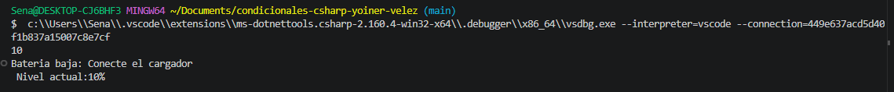

# Problema 04. Alerta de bateria

**Estructura elegida:** Operador terniario

**Justificación:** se eligio esta estructura ya que es la mas adecuada para solo dos unicas opciones, debido a que cumple con la solucion del problema y al mismo tiempo optimiza las lines de codigo

**Evidencia:**
