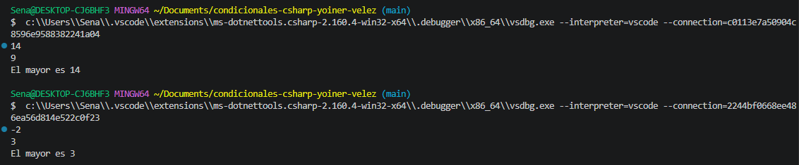

# Problema 05. El mayor de dos numeros

**Estructura elegida:** if else if

**Justificación:** se hizo esta estructura para evitar errores al poner dos numeros exctamente igual, en caso de que no existiera este error se hubiera utilizado el operador terniario

**Evidencia:**
