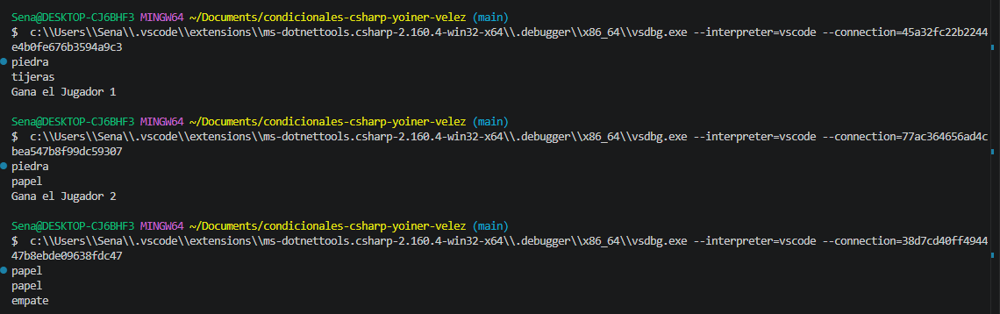

# Problema 06. piedra papel o tijera    

**Estructura elegida:** if elseif

**Justificación:** se utilizo esta estructura debido a que el problema representa multiples caminos excluyentes de victoria,empate y derrota ayudando a evaluar cada escenario de forma independiente

**Evidencia:**
