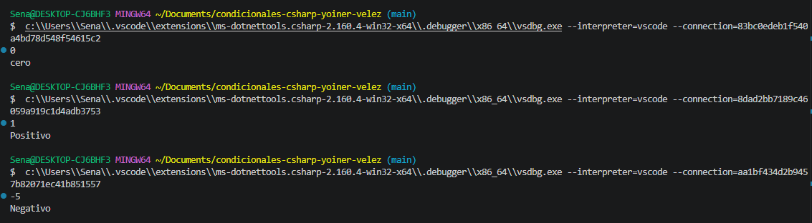

# Problema 07. Signo de un numero

**Estructura elegida:** switch expression

**Justificación:** se uso porque es una opcion que optimiza el codigo ademas de cumplir las condiciones suficientes para comparar los numeros respectivos

**Evidencia:**
