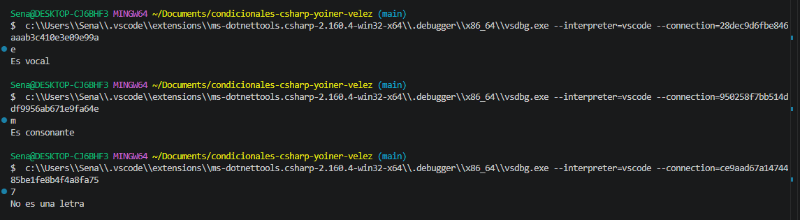

# Problema 08. Vocal o consonante

**Estructura elegida:** if else anidado

**Justificación:** Se utilizó la estructura porque el problema presenta caminos mutuamente excluyentes Esto permite evaluar de forma directa la condición principal de las vocales y utilizar el bloque else para capturar de manera limpia

**Evidencia:**
