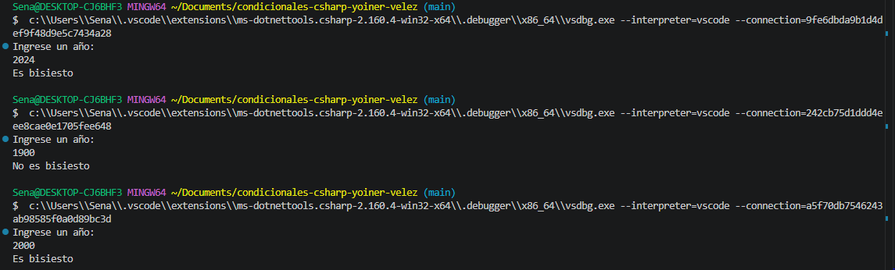

# Problema 09. Año bisiesto

**Estructura elegida:** if else

**Justificación:** Se utilizó la estructura porque el problema requiere evaluar reglas lógicas y matemáticas compuestas. Esto permitió validar de forma directa dicha condición principal y manejar mediante el bloque else el resultado alternativo, dividiendo el flujo en dos únicas respuestas posibles de manera limpia y eficiente.

**Evidencia:**
