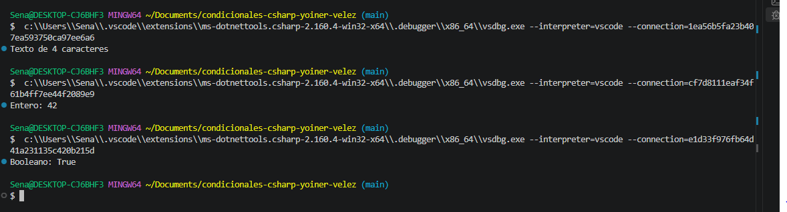

# Problema 10. Analizador de datos recibidos

**Estructura elegida:** if elseif

**Justificación:** se utilizo esta estructura debido a las multiples condiciones que rodeaban a este problema siendo la estructura que mas encajaba en esto

**Evidencia:**
