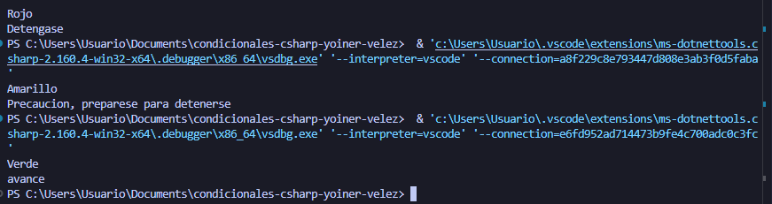

# Problema 11. Semáforo inteligente

**Estructura elegida:** Switch tradicional

**Justificación:** se utilizo la estrucutra debido a que no era un sisteme en el que se tenian que comparar enteros o parecidos, y solamente selecciones simples de colores

**Evidencia:**
