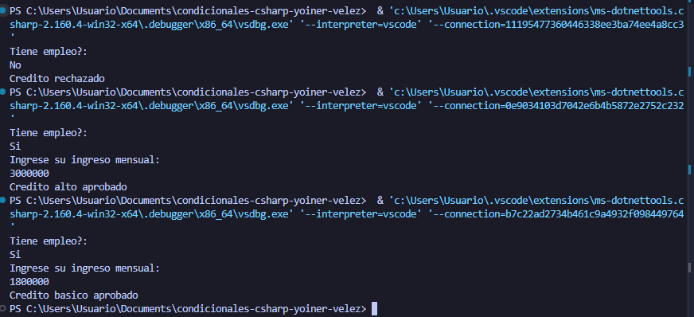

# Problema 12. Aprobación de crédito

**Estructura elegida:** if elseif anidado

**Justificación:** se utilizo esta estructura debido a que se validan varias cosas desde el inico cuando se pregunta si es empleado y al final cuando se valida el ingreso

**Evidencia:**
