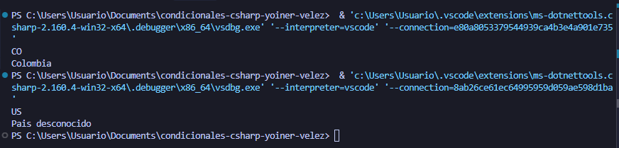

# Problema 13. Códigos de país

**Estructura elegida:**  Switch expressions

**Justificación:** Se utilzo el tipo de estructura debido al ser mas optimizado y simple para utilizar en este caso 

**Evidencia:**

