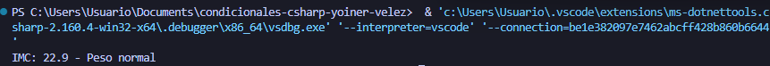

# Problema 15. Índice de masa corporal

**Estructura elegida:** switch

**Justificación:** Se usó la estructura con patrones relacionales porque evalúa rangos numéricos continuos de forma secuencial, legible y compacta.

**Evidencia:**

