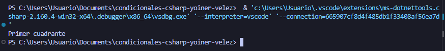

# Problema 16. Ubicación de un dron

**Estructura elegida:** switch expression

**Justificación:** Se usó una expresión switch con patrones de tuplas ya que permite evaluar múltiples condiciones geométricas simultáneamente.

**Evidencia:**

