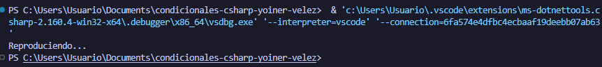

# Problema 17. Control de un reproductor

**Estructura elegida:** switch expression

**Justificación:** Se usó una expresión switch simple porque mapea de forma directa y limpia cadenas de texto exactas a resultados específicos.

**Evidencia:**

