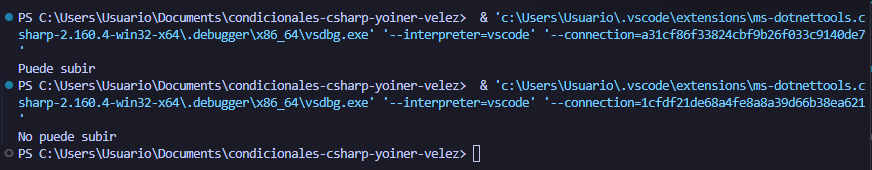

# Problema 18. Montaña rusa

**Estructura elegida:** operador terciario

**Justificación:** Se usó una estructura de operador terciaro debido a la combinacion de operadores lógicos y a la complejidad de las reglas de negocio compuestas por condiciones múltiples.

**Evidencia:**

