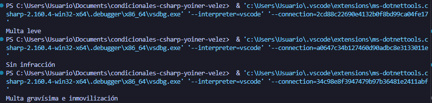

# Problema 19. Radar de velocidad

**Estructura elegida:** operador terciario

**Justificación:**Se usó una expresión switch con patrones relacionales para estructurar umbrales numéricos ordenados y evitar anidamientos excesivos de if-else

**Evidencia:**

