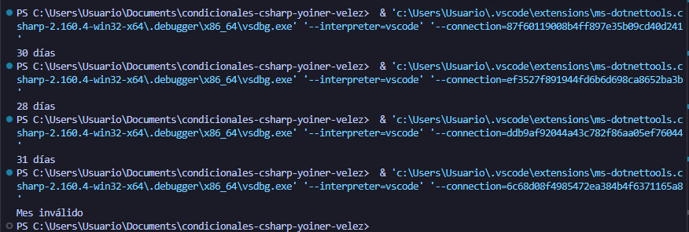

# Problema 20. Días de cada mes

**Estructura elegida:** switch Expression

**Justificación:**Se usó una expresión switch con patrones lógicos porque permite agrupar múltiples meses que comparten exactamente la misma cantidad de días en un solo caso.

**Evidencia:**
