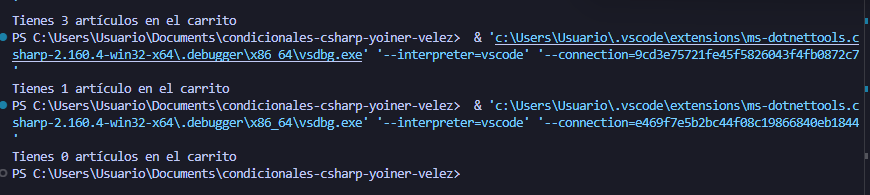

# Problema 21. Carrito de compras

**Estructura elegida:** operador terniario

**Justificación:**Se usó el operador ternario dentro de una interpolación de cadenas para alternar dinámicamente entre singular y plural cumpliendo la restricción de una sola línea.

**Evidencia:**

