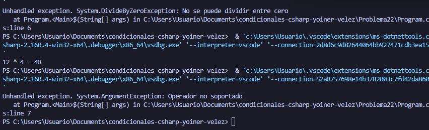

# Problema 22. Calculadora básica

**Estructura elegida:** switch expression

**Justificación:**Se usó una expresión switch porque permite integrar el lanzamiento directo de excepciones dentro de cada rama de operación de forma fluida.

**Evidencia:**
