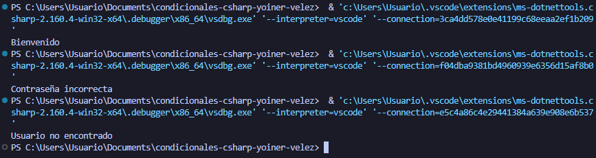

# Problema 23. Inicio de sesión

**Estructura elegida:** if else

**Justificación:** Se usaron estructuras if-else anidadas porque el proceso exige validaciones secuenciales estrictamente dependientes

**Evidencia:**

