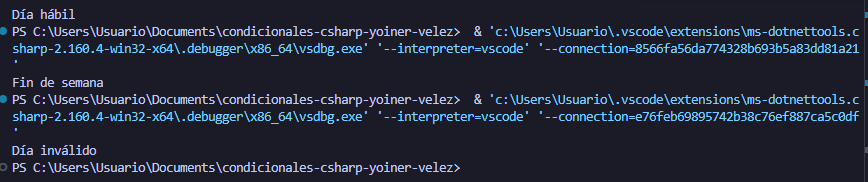

# Problema 24. ¿Día hábil?

**Estructura elegida:** switch Expression

**Justificación:** Se usó una expresión switch con patrones lógicos avanzados para evaluar y clasificar rangos numéricos de días de manera compacta.

**Evidencia:**

