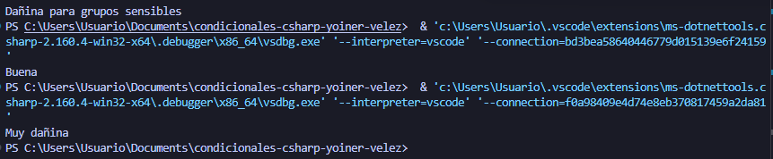

# Problema 25. Calidad del aire

**Estructura elegida:** switch Expression

**Justificación:** Se usó una expresión switch con patrones relacionales por su alta legibilidad al evaluar de forma descendente los umbrales del índice de calidad del aire.

**Evidencia:**

