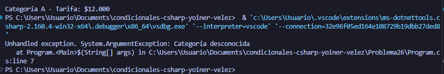

# Problema 26. Peaje

**Estructura elegida:** switch Expression

**Justificación:** Se usó una expresión switch porque mapea de forma óptima caracteres discretos a sus respectivas tarifas y permite lanzar una excepción limpia en caso de categorías inválidas.

**Evidencia:**
