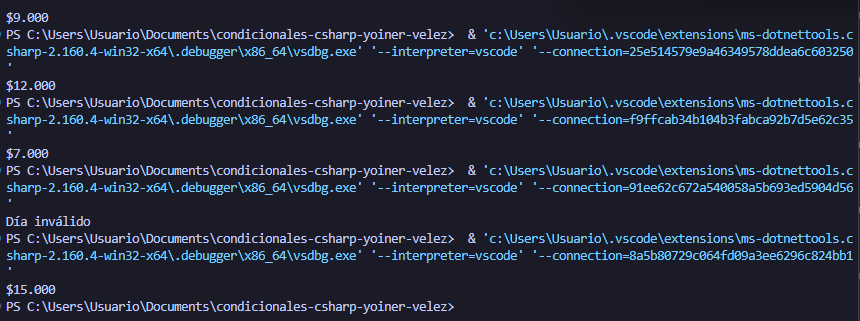

# Problema 27. Taquilla de cine

**Estructura elegida:** switch Expression

**Justificación:** SSe usó una expresión switch con patrones de tuplas (string, bool) para resolver una matriz de decisión cruzada basada en dos variables independientes al mismo tiempo.

**Evidencia:**

