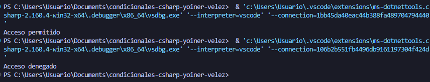

## Problema 29. Control de acceso a la sede

**Estructura elegida:** switch Expression y operador terniario

**Justificación:** Se usó una expresión switch con patrones de tuplas combinados con rangos numéricos porque facilita la validación cruzada de roles de usuario frente a restricciones horarias.

**Evidencia:**

