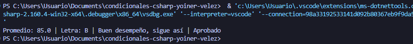

## Problema 30. Boletín de calificaciones (integrador)

**Estructura elegida:** switch Expression

**Justificación:** Se utilizaron múltiples expresiones switch modulares para desacoplar la conversión de notas, la generación de mensajes y el cálculo de estados en un proceso integrador por fases.

**Evidencia:**

